# Minutes: meeting intelligence

Upload a meeting transcript and get a summary, decisions, action items and a chat you can question. Every answer links back to the exact lines in the transcript.

Built for assignment **Option 3: Meeting Intelligence**.

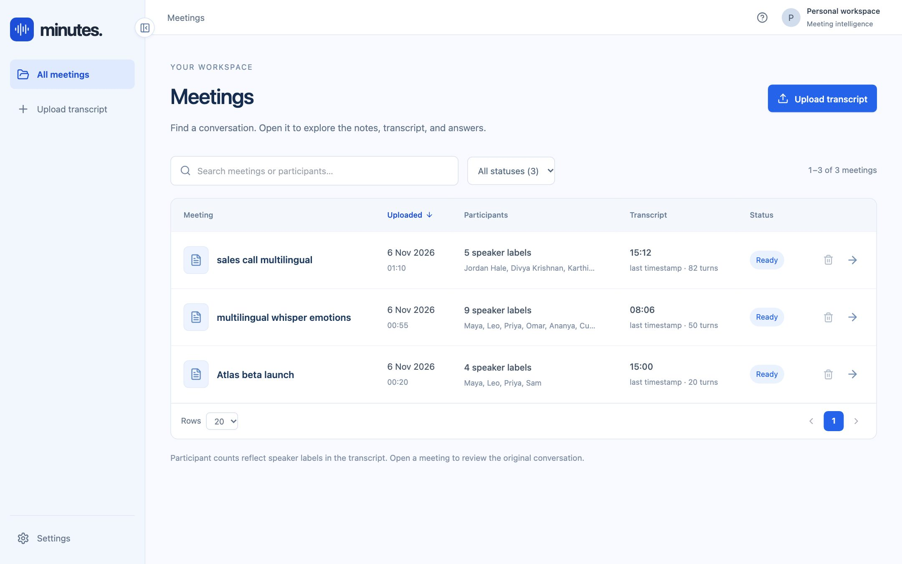

> **Status:** proof of concept. One shared workspace with no user accounts. The hosted demo sits behind a single login.

---

## What it does

| Area | What you get |
|---|---|
| **Import** | Upload one or more files: timestamped `.txt`, Otter/Google Meet exports, Zoom/Teams `.vtt`, and `.srt`. Comment lines and untimed transcripts are accepted; for untimed files, times are estimated and marked as such. |
| **Processing** | Uploads go into a database-backed queue. A live progress view shows each step while Claude reads the meeting. |
| **Overview** | Summary, confirmed decisions and open questions, each linked to its transcript evidence. |
| **Transcript** | Four views:<br>• **Conversation**: each turn marked with emoji and labels for questions, decisions, actions, risks, proposals and emotions, with filters.<br>• **By speaker**: collapsible sections with a per-person summary and talk time.<br>• **Timeline**: speaking lanes with marked moments.<br>• **Original**: the uploaded file exactly as received. |
| **Action items** | Owner, deadline and evidence for each item. Calendar, Email, Jira and PR buttons are placeholders that show where integrations would go. |
| **Ask your meeting** | Chat about the meeting. Answers cite the passages they used and say so when the transcript doesn't cover the question. Follow-up questions keep context. |
| **Voice agent** | Talk to the meeting through ElevenLabs Agents, using the same evidence. |
| **Library** | Server-side search, status filter with counts, sorting, pagination, and delete. |
| **Onboarding** | A 6-step product tour on first visit, plus a 6-step tour of the meeting page. Replay either with the **?** button. |
| **Settings** | Connect, replace or remove the Anthropic and ElevenLabs keys. Keys are stored encrypted in the database and stay connected after restarts. |
| **Languages** | Transcripts in any language, including mixed-language meetings. Notes are written in English; chat answers in the language of the question. |

## Screenshots

| | |
|---|---|
| 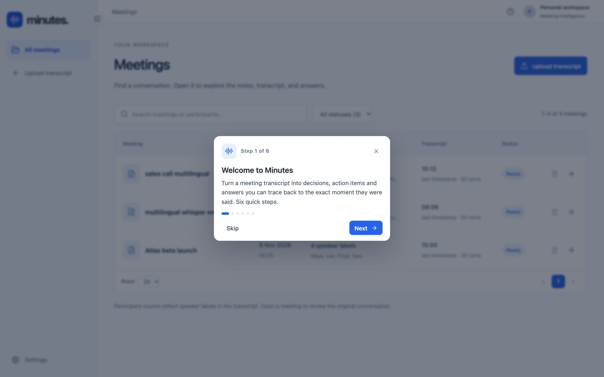 First-run tour | 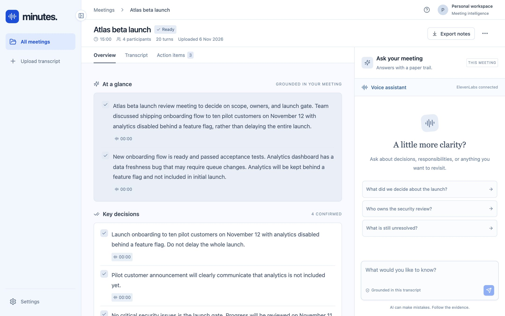 Overview and chat |
| 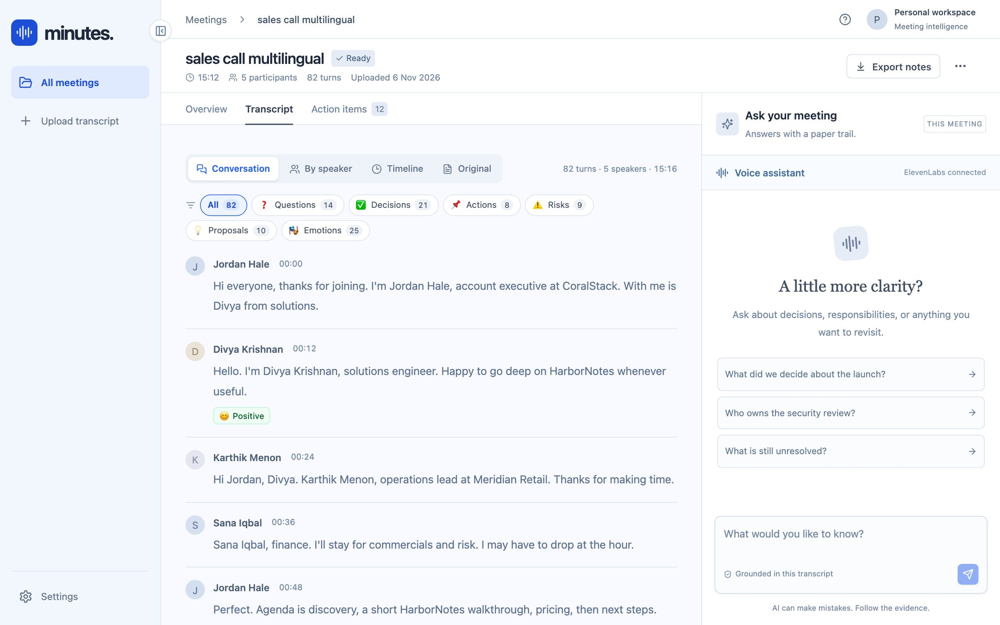 Conversation with marks | 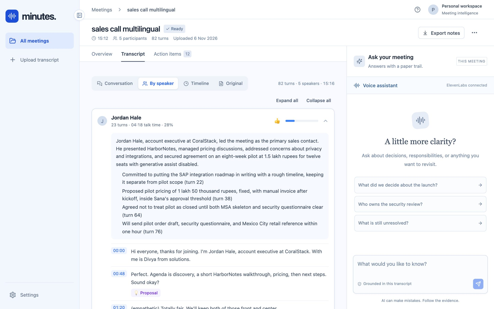 Per-speaker summaries |
| 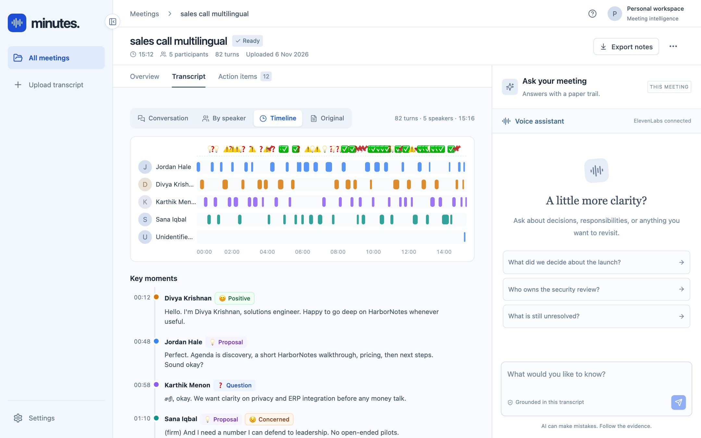 Timeline | 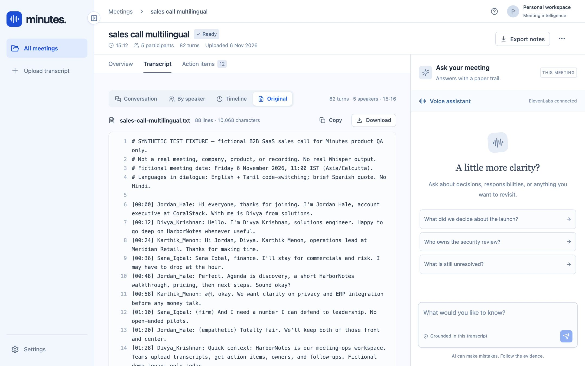 Original file |
| 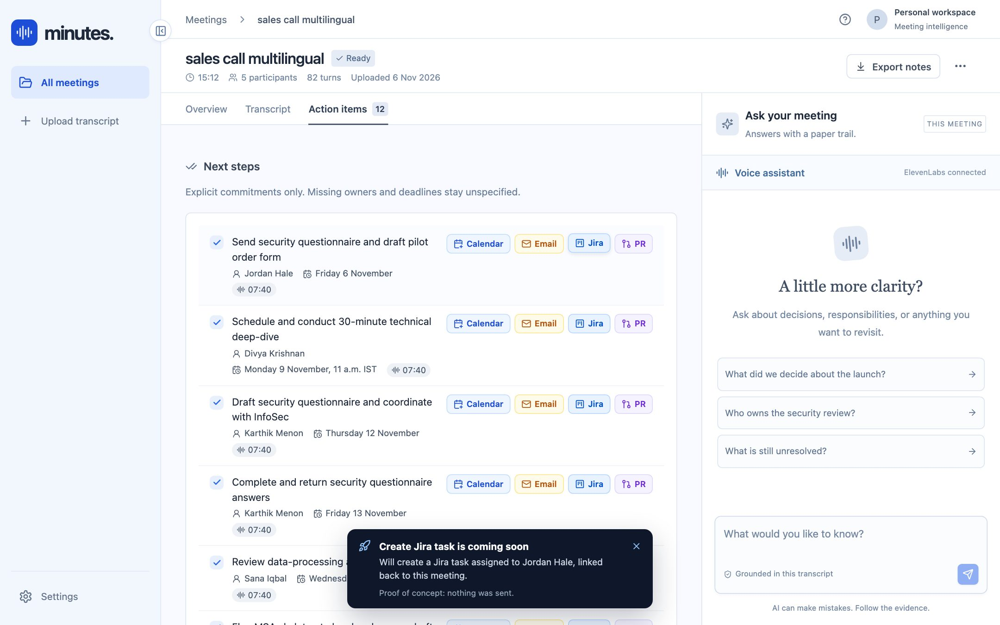 Action items (integrations are placeholders) | 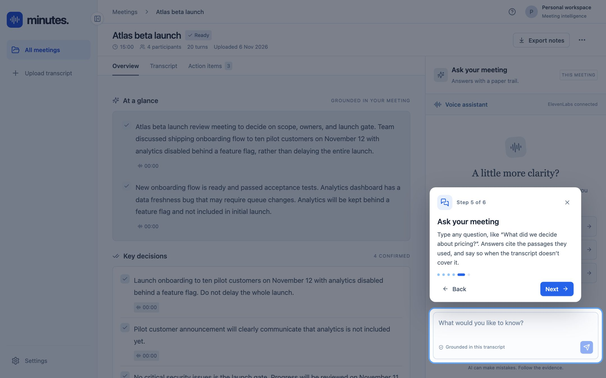 Meeting tour: chat |
| 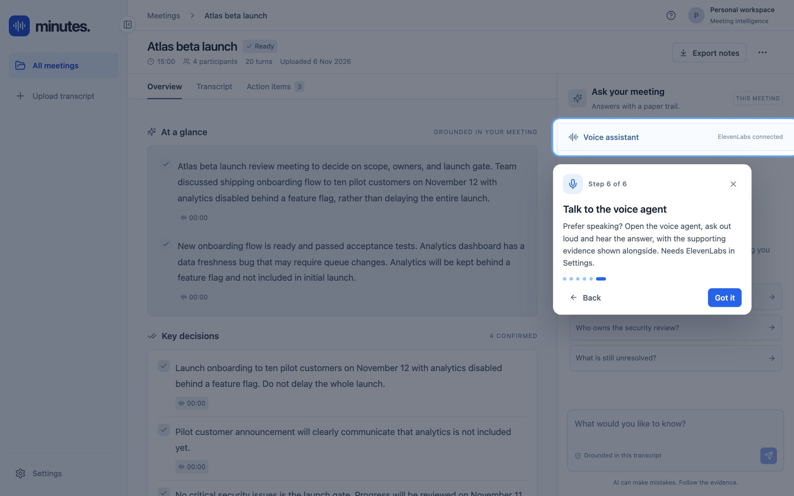 Meeting tour: voice agent | 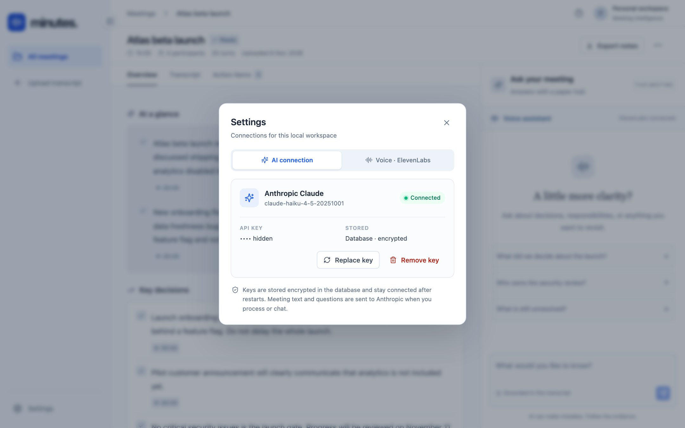 Settings |

---

## Run it locally

Requirements: Python 3.12+, [uv](https://docs.astral.sh/uv/), Node.js 22.

```bash
cp .env.example .env          # optional: set DATABASE_URL (SQLite by default, or Supabase)
./scripts/dev.sh start        # installs, migrates, starts the API on :8000 and the UI on :5173
```

Open http://localhost:5173. Then:
1. Click **Settings** at the bottom of the sidebar and connect your Anthropic key. Without a key the app runs in demo mode, which returns matching excerpts instead of generated notes.
2. Optionally connect ElevenLabs for the voice agent.
3. Upload a transcript, or try `samples/Atlas beta launch.txt`.

Other commands: `./scripts/dev.sh status | logs | restart backend | stop`, and `make test`.

## Hosting (POC)

`./scripts/prod.sh start` builds the frontend, runs migrations, and serves everything from one uvicorn process. It is published through a Cloudflare Quick Tunnel (no domain needed) behind HTTP Basic auth. `./scripts/prod.sh deploy` ships changes and keeps the same URL. The full runbook is in [docs/operations.md](docs/operations.md).

---

## How it works

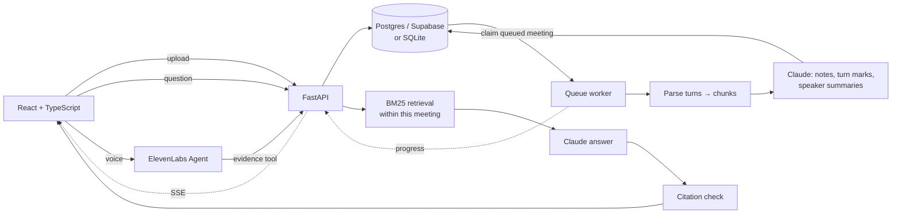

| Part | Implementation |
|---|---|
| Backend | FastAPI, SQLAlchemy 2, Alembic migrations (`001`–`006`) |
| Database | Supabase Postgres (session pooler) for dev and hosted; SQLite (WAL) also supported. Row Level Security is enabled so Supabase's public Data API can't read the tables. |
| Queue | A background thread polls the `meetings` table and claims work with a conditional `UPDATE`. Progress is stored on the meeting and streamed over Server-Sent Events; the UI falls back to polling when a proxy buffers the stream. |
| Parsing | Tolerant line parser plus VTT/SRT cues. Whole speaker turns are grouped into ~1,800-character chunks with one turn of overlap. |
| AI | Claude Haiku 4.5 with structured outputs (Pydantic schemas) for notes, per-turn marks and speaker summaries. |
| Retrieval | Unicode-aware BM25, always scoped to one meeting. Meetings under 14,000 characters are sent whole. The last six chat messages are used to rewrite follow-up questions. |
| Citations | Answers must cite chunk IDs from the supplied context; anything else is rejected. |
| Voice | ElevenLabs Agents over WebRTC. The agent calls a browser tool that fetches evidence from the API. Sessions last up to 10 minutes. |
| Secrets | Keys are encrypted with Fernet in an `app_settings` table. The encryption key comes from an environment variable or `.secrets/settings.key`. |
| Frontend | React 19, Vite, lucide icons, hash routing; tested with Vitest and Testing Library. |

## Tests

```bash
make test        # backend pytest + frontend vitest
```

Backend tests cover parsing of many formats (including a mixed English/Tamil fixture), chunking, retrieval, citation validation, the queue and progress, encrypted settings, the list API (search, filter, sort, paging), hosting auth, and provider flows using test doubles. Frontend tests cover the library, upload, settings, transcript views, action items, tours and delete.

A live Claude check on the sample meeting is recorded in [docs/evaluations/claude-core-2026-11-05.json](docs/evaluations/claude-core-2026-11-05.json).

## Known limitations

- No user accounts or per-user data isolation; one shared workspace.
- Queue recovery on startup marks every `processing` meeting as failed. That is wrong if two servers share one database.
- Retrieval is lexical (BM25), not semantic embeddings. Paraphrased questions can miss.
- Valid citation IDs don't prove that an answer follows from the cited text.
- Calendar, Email, Jira and PR buttons are placeholders.
- The Quick Tunnel URL changes if the host machine restarts or loses its network connection.

---

## My approach and decisions

<!-- TODO (author): write this section in your own words. -->

## Trade-offs

<!-- TODO (author) -->

## What I'd do next / productionization

<!-- TODO (author) -->

## How I used AI tools

<!-- TODO (author) -->

## Demo video

<!-- TODO (author): Loom link -->
