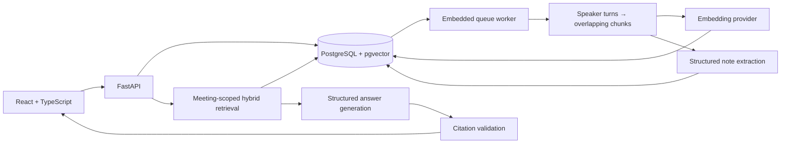
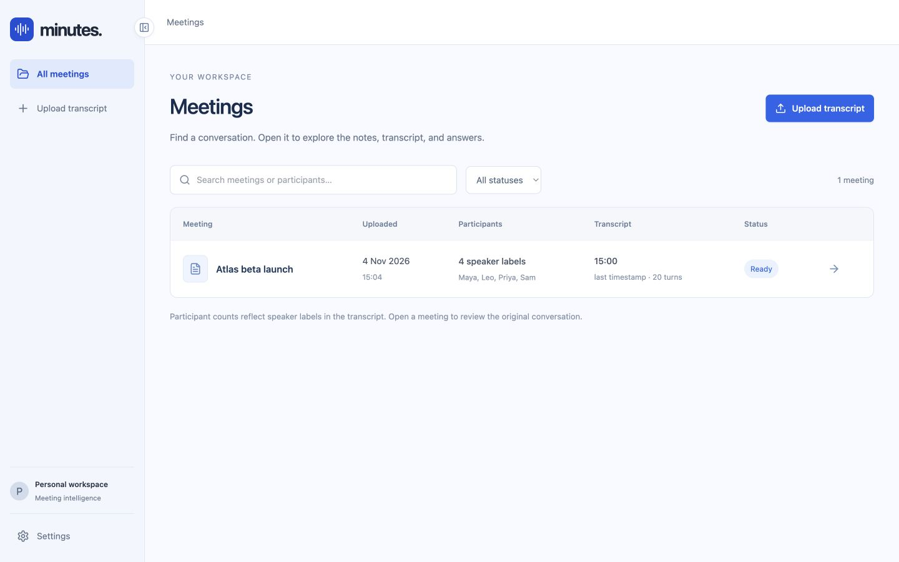
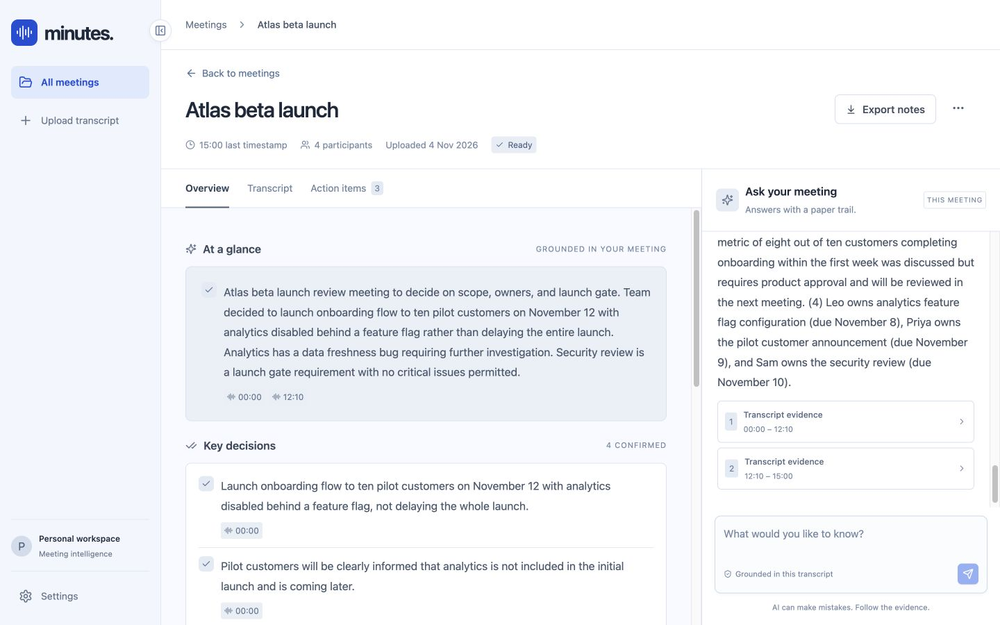

# Minutes — Meeting Intelligence

A focused meeting workspace: upload a timestamped transcript, inspect the conversation, and ask questions with clickable source evidence. Built for assignment Option 3.

**Status:** Local MVP. Automatic meeting attendance and calendar integration are not implemented. Voice questions and spoken answers are available through ElevenLabs. This is a single-user development app, with no authentication; do not expose it publicly as-is.

## Quick start

### Local development (SQLite; no Docker required)

Requires Python 3.12+, [uv](https://docs.astral.sh/uv/), and Node.js 22+.

```bash
cd meeting-intelligence
cp .env.example .env
cd backend
uv sync --frozen
uv run uvicorn app.main:app --host 127.0.0.1 --port 8000
```

In another terminal:

```bash
cd meeting-intelligence/frontend
npm ci
npm run dev
```

Open http://localhost:5173. Vite proxies `/api` to the backend. SQLite persists to `backend/meeting.db`; startup creates its development schema. PostgreSQL uses Alembic migrations, run automatically by the API container. Run only **one API process** for this MVP: its embedded worker recovers interrupted work on startup.

### Enable AI generation

**Claude / Anthropic:** Open **Settings** at the bottom of the sidebar, enter your Anthropic API key in the password field, then click **Connect and enable AI**. A short provider request checks access before enabling AI. The selected meeting is reprocessed automatically. Wait for **ready**, then ask a question. Keys entered in this dialog live only in backend memory and are cleared when the backend restarts. Never paste a key into chat or commit it to Git.

For persistent local configuration, set `AI_MODE=anthropic` and `ANTHROPIC_API_KEY` in the ignored project-root `.env` and restart the backend. `ANTHROPIC_MODEL` defaults to `claude-haiku-4-5-20251001`. Claude mode uses local BM25 retrieval with no embedding API. For meetings whose chunks fit within 14,000 characters, the full discussion is provided so generic questions and later corrections have context; longer meetings use the top matching chunks. This is lexical retrieval, not semantic embeddings. Meeting content is sent to Anthropic for notes and answers.

The settings endpoint is for the loopback-bound, single-user prototype only. It requires a custom request header, checks browser Origin, and does not return or persist the key. It must be authenticated or removed before hosting this app.

**OpenAI:** Set `AI_MODE=openai` and `OPENAI_API_KEY` in the project-root `.env`, then restart the backend. Upload a new transcript or select **Meeting options → Reprocess meeting**; reprocessing clears previous notes and chat history. The key stays on the backend. Transcript contents and questions are sent to OpenAI in this mode.

Demo mode is the default and requires no key. It returns matching transcript excerpts, not generated summaries or conversational answers. Click **Explore a sample** to try it.

### Optional container setup

Docker is not needed for local development. The existing `compose.yaml` packages PostgreSQL/pgvector, the API, and frontend for later use. With a running Docker daemon, `docker compose up --build` serves the app at http://localhost:8080. This path has not been runtime-verified here.

## Voice assistant (ElevenLabs)

1. Open **Settings → Voice · ElevenLabs**, enter a valid replacement ElevenLabs key, and click **Connect ElevenLabs**. The key needs voice-read, speech-to-text, and text-to-speech access. The app verifies voice-read access; STT/TTS permissions and credits are checked when used.
2. Connect Claude in **Settings → AI connection** if needed, then open a ready meeting.
3. Expand **Voice assistant**, click **Open conversation agent**, then press **Start conversation**. Allow microphone access. Speak a question and pause: local silence detection commits the turn after approximately 1.2 seconds of silence following speech.
4. The app transcribes the question, submits it to the same meeting-scoped answer endpoint, generates speech, plays the answer automatically, and returns to **Listening**. Both sides of the conversation and citations appear in chat.
5. **Interrupt & speak** stops playback and starts another listening turn. **End conversation** aborts local pending requests/playback and releases microphone access. Switching meetings also ends the session. A server-side generation already underway can still complete after client cancellation.

The interface displays Connecting, Listening, Understanding, Finding evidence, Preparing voice, and Speaking states. Manual recording/review and playback are still available under **Manual voice controls**.

Pipeline: microphone → local speech/silence detection → ElevenLabs Scribe → Claude/OpenAI with meeting evidence → ElevenLabs speech → playback → listen again. This is automatic two-way turn-taking, not full-duplex audio streaming or a hosted ElevenAgents bot. Interrupting playback requires the Interrupt button; speaking over the assistant does not automatically interrupt it. Latency includes separate STT, answer-generation, and TTS requests. Quiet surroundings help the simple RMS speech gate; no speech for 30 seconds ends the session. An individual spoken turn is capped at 30 seconds and the existing 5 MB upload limit.

Audio recordings and generated audio are not persisted by this app. Audio questions and answer text are sent to ElevenLabs and use account credits; provider retention follows your ElevenLabs account policy. Keys entered through Settings remain only in backend memory until restart. Use ignored `.env` variables `ELEVENLABS_API_KEY`, `ELEVENLABS_VOICE_ID`, `ELEVENLABS_STT_MODEL`, and `ELEVENLABS_TTS_MODEL` for local persistent configuration. Microphone recording requires localhost/HTTPS and a compatible browser. Multilingual availability depends on the configured STT/TTS model and voice; not every language has been tested.

Provider references: [speech transcription](https://elevenlabs.io/docs/api-reference/speech-to-text/convert), [speech generation](https://elevenlabs.io/docs/api-reference/text-to-speech/convert).

## Features

- Optional voice questions and spoken answers via ElevenLabs, with review-before-send.
- UTF-8 `.txt` upload, with line-specific timestamp/format errors and bounded input size.
- Meeting library, processing states, retry, and deletion of associated chunks and chat.
- Speaker-labelled transcript viewer and source evidence panel.
- AI mode: structured summaries, confirmed decisions, action items, unresolved questions, and conversational answers.
- Evidence citations validated against the actual retrieved context.
- Missing action owners/deadlines displayed as “Not specified.”
- Persistent conversation history and bounded follow-up query rewriting in AI mode.
- Markdown notes export, including supporting transcript passages.
- Explicit offline demo, sample transcript, request IDs, provider usage logs, tests, and containers.

Supported input (one speaker turn per line; blank lines allowed):

```text
[00:00] Maya: Let's review the launch.
[00:35] Sam: I will finish the security review by November 10.
[01:02:15] Maya: We agreed to launch only after the review passes.
```

Limits: 250 KB encoded upload, 60,000 decoded characters, 6,000 characters per turn, chronological timestamps. The displayed duration is the **last recorded timestamp**, not a measured recording length. Dates mentioned in speech remain as spoken; the app does not invent a year or resolve relative deadlines.

## Architecture



One frontend, one backend process, one database. No agent framework or separate vector service. `app/ai.py` owns provider calls; `transcripts.py` owns parsing/chunking; `intelligence.py` owns retrieval/validation; `worker.py` owns ingestion; `main.py` owns HTTP boundaries. PostgreSQL and SQLite use the same SQLAlchemy models with a dialect-specific embedding column.

Uploads return `202` with a queued meeting. The worker claims queued rows, generates embeddings/notes, and commits the result atomically. Failures roll back partially generated chunks and mark the meeting failed. Queued rows survive restarts; interrupted processing becomes retryable. The UI polls while work is active. This worker is intentionally single-process, not a production distributed job system.

## RAG and LLM decisions implemented

| Area | Implementation and trade-off |
|---|---|
| Chunking | Whole speaker turns, ~1,800 character target, one turn overlap. Preserves attribution and adjacent discussion; characters are a simple approximation, not token-accurate. Oversized turns remain intact within the 6,000-character limit. |
| Embeddings | `text-embedding-3-small`, explicitly 1,536 dimensions. One hosted provider simplifies setup. Local embeddings would remove embedding API costs but add model download/runtime management. |
| LLM | Anthropic Claude Haiku 4.5 or configurable OpenAI `gpt-4o-mini` default for structured extraction/answers. This is a starting configuration, not a claim that it wins a model benchmark. Evaluate on your transcripts before selecting a final model. |
| Vector storage | pgvector alongside relational data. Pinecone/Qdrant would add an operational dependency this corpus does not yet justify. SQLite performs Python cosine ranking for local development. |
| Retrieval | BM25-style lexical scores plus semantic cosine ranking, combined by reciprocal rank fusion. Top five chunks, up to 14,000 evidence characters in AI mode. Lexical matching helps names and exact terms; vectors help paraphrases. |
| Scope | Every retrieval query filters by meeting ID. Cross-meeting questions are not supported. No tenant isolation is claimed: the app has one shared workspace. |
| Context | Last six messages, each capped at 1,600 characters, inform a standalone query rewrite. Retrieved evidence, not past model responses, is the factual source. |
| Notes | Extract over batches of six chunks; concatenate and deduplicate exact item text. Covers the full transcript without silently dropping its ending. A later decision in another batch can contradict an earlier one: temporal reconciliation is future work. |
| Orchestration | Plain Python functions and the provider SDK. Avoids hidden retrieval/prompt behavior and framework overhead. |
| Guardrails | Structured Pydantic output, nonempty/valid citation IDs for supported claims, explicit insufficient-evidence responses, untrusted-source instructions, no tool execution, bounded requests, timeouts. |

Valid citation IDs do **not** prove that a claim follows from the evidence. Prompt injection and unsupported synthesis remain model risks. The prompt asks the model to distinguish proposals from decisions and avoid invented owners/deadlines; this needs live evaluation, not just schema tests. Demo retrieval can return loosely relevant passages and is not semantic reasoning.

Provider documentation used: [Anthropic structured outputs](https://platform.claude.com/docs/en/build-with-claude/structured-outputs), [structured outputs](https://developers.openai.com/api/docs/guides/structured-outputs?api-mode=responses), [embeddings](https://developers.openai.com/api/docs/guides/embeddings).

## Tests and observability

```bash
cd backend
uv run pytest -q
# In frontend/
npm test
npm run build
```

Backend tests cover format validation, complete chunk coverage/overlap, citation rejection, lexical ranking, meeting isolation, persisted chat, delete cascades, retry cleanup, and provider failure states. Frontend tests cover empty state, honest mode labelling, upload dialog behavior, and API errors. Provider behavior is also tested with doubles; these are **not** live LLM quality evaluations. See `docs/evaluation.md` for human-review cases.

Logs contain request IDs, method, status, latency, meeting IDs, exception type, and provider token counts. They exclude transcript/prompt text and credentials. `GET /api/health` checks database connectivity; it does not spend tokens to probe the model provider. There is no metrics backend or tracing exporter yet.

Engineering practices: typed frontend, validated API bodies and model outputs, separated modules, deterministic tests, pinned dependency lockfiles, migrations, explicit failure states, non-root API container, responsive/keyboard-accessible controls. Skipped: auth, multi-tenant authorization, load tests, a distributed worker, automatic live-provider evals, and a complete accessibility audit.

## Productionization: suggested AWS path

1. Add OIDC sign-in, workspace membership, and server-enforced ownership checks on **every** meeting, source, and chat operation. Add per-user request and token budgets.
2. Deploy frontend assets behind CloudFront; run the API on ECS/Fargate behind an HTTPS ALB. Run schema migrations as a one-off deployment job.
3. Use RDS PostgreSQL with pgvector, private networking, connection limits/pooling, encryption, backups, and tested restore procedures. Store large original transcripts in S3 with lifecycle policies.
4. Replace the embedded worker with SQS and separate ingestion workers. Add job leases, idempotency keys, bounded retries, and a dead-letter queue. Preserve the current separation between provider calls and database writes.
5. Put API keys in Secrets Manager. Add retention/deletion policies for transcripts, derived data, backups, and the external AI provider. Confirm participant disclosure/consent before adding recording bots.
6. Add OpenTelemetry/CloudWatch metrics for queue age, processing failures, retrieval latency, provider latency, token cost, and request rate. Redact content by default.
7. Profile before adding an approximate vector index. Current per-meeting corpora use exact ranking. At scale, test HNSW indexing, filtering behavior, and recall on representative data.
8. Gate releases with retrieval recall, answer faithfulness, decision-vs-proposal, missing-owner, and prompt-injection evaluations. Version prompts and embedding models; reindex explicitly when they change.

The supplied local database credentials and loopback-bound ports are development configuration, not a deployment security model.

## AI-assisted development and your submission

Implementation, initial tests, UI, and documentation were drafted with Codex. This README describes the delivered implementation and its trade-offs; it is **not** presented as the candidate's personal thought process. Review the code and replace/augment the decision discussion in your own words before submission.

Use `docs/candidate-reflection.md` to record which suggestions you accepted/rejected, which tests you ran, what failed, and why the trade-offs suit your constraints. Do not claim an unrun live-provider evaluation, an unrecorded demo, or a deployment that has not happened.

## With more time

First: authenticated ownership, live quality evaluation, temporal decision reconciliation, and durable independent workers. Next: meeting-bot ingestion with verified webhooks and idempotency, calendar opt-in, meeting-recording transcription, cross-meeting decisions, and streaming chat. Automatic meeting attendance should feed the same ingestion contract rather than introduce a second intelligence pipeline.

## Submission materials

- Source: this directory is self-contained and can become its own GitHub repository. Repository publication status is recorded in `docs/verification.md`.
- Sample: `samples/Atlas beta launch.txt`.
- Evaluation checklist: `docs/evaluation.md`.
- Personal reflection prompts: `docs/candidate-reflection.md`.
- Loom walkthrough outline: `docs/demo-walkthrough.md` (record the video yourself).
- Verification results: `docs/verification.md`.

## Screenshots

These show the real application in demo mode.





Submission readiness and remaining work: [submission checklist](docs/submission-checklist.md).

Live Claude verification: four sample checks passed (owner/deadline, follow-up, unsupported budget, proposed versus approved metric). See [the recorded evaluation](docs/evaluations/claude-core-2026-11-05.json) for actual responses and scope.

Navigation: the home screen lists meetings with title/participant search and a status filter. Select a meeting to open its details; **Back to meetings**, browser Back/Forward, and bookmarked `#/meetings/<id>` URLs are supported. The sidebar collapse handle sits on the top divider beside the logo, and the preference is saved locally. AI connection status and credentials are managed through **Settings**.

The dedicated voice-agent window displays the selected meeting, an animated status orb, a live transcript, and Start/Interrupt/End controls. Closing the window or pressing Escape ends the session and releases the microphone. The agent offers direct AI setup when the reasoning connection is missing.
